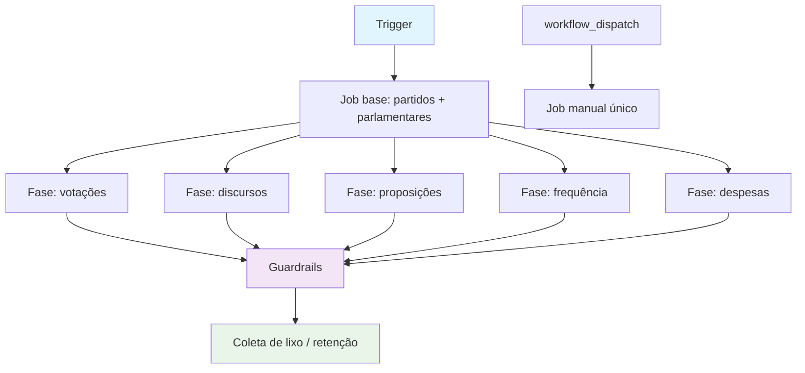

## Workflow Overview

**Purpose**: manter completos os dados oficiais de Câmara e Senado na janela de 3 anos (2024–2026), diariamente e de forma retomável.
**Trigger Events**: `schedule` (Câmara 03:00 UTC, Senado 04:00 UTC) e `workflow_dispatch` (execução manual com filtros de fase/ano/faixa).
**Target Environments**: banco PostgreSQL de produção (Neon) + GitHub Actions (ubuntu-latest).

## Execution Flow Diagram



## Jobs & Dependencies

| Job Name | Purpose | Dependencies | Execution Context |
|----------|---------|--------------|-------------------|
| base | Sincroniza partidos e parlamentares (referência) | — | ubuntu-latest, 360 min |
| fase (matrix) | Sincroniza UMA fase nos 3 anos (votações/discursos/proposições/frequência/despesas) | base | ubuntu-latest, 360 min por ramo |
| guardrails | Valida invariantes de integridade (sem nominais órfãs, enriquecimento OK) | todas as fases | ubuntu-latest |
| retencao | Remove dados fora da janela de 3 anos | guardrails | ubuntu-latest |
| manual (só dispatch) | Execução única respeitando inputs | — | ubuntu-latest |

## Requirements Matrix

### Functional Requirements
| ID | Requirement | Priority | Acceptance Criteria |
|----|-------------|----------|-------------------|
| REQ-001 | Cada fase agendada roda isolada; falha ou lentidão de uma não impede as demais | High | Job por fase via matrix; `fail-fast: false` |
| REQ-002 | Cada fase cobre 2024, 2025 e 2026 sequencialmente | High | Loop sobre `scripts/anos-janela.ts` |
| REQ-003 | Falha transitória da fonte (5xx, P1017, reset) é retentada | High | Até 3 tentativas por ano, com espera; upserts idempotentes |
| REQ-004 | Execução manual continua aceitando `--apenas-*`, `--ano`, `--offset`, `--limite` | Medium | Job `manual` preservado sem alteração de contrato |
| REQ-005 | Guardrails e retenção só rodam após todas as fases | Medium | `needs` explícito |

### Security Requirements
| ID | Requirement | Implementation Constraint |
|----|-------------|---------------------------|
| SEC-001 | Permissões mínimas do token | `permissions: contents: read` no topo |
| SEC-002 | Sem interpolação de input não confiável em `run` | Args de matrix vêm de constantes do YAML, expostas via `env` |
| SEC-003 | Segredos só via `secrets`, nunca em log | `DATABASE_URL`, `PORTAL_API_KEY` mapeados em `env` |

### Performance Requirements
| ID | Metric | Target | Measurement Method |
|----|-------|--------|-------------------|
| PERF-001 | Duração da fase de votações (Câmara) | < 15 min / 3 anos | log da execução agendada |
| PERF-002 | Nenhuma fase agendada é cancelada por teto de tempo | 0 cancelamentos | status dos jobs do run agendado |

## Input/Output Contracts

### Inputs

```yaml
# workflow_dispatch (Câmara e Senado)
ano: string                 # Ano específico (padrão: ano corrente)
apenas-parlamentares: bool
apenas-votacoes: bool
apenas-discursos: bool
apenas-proposicoes: bool
apenas-frequencia: bool
apenas-despesas: bool
bulk: bool                  # Câmara: usa JSON oficial em lote (padrão true)
offset: string              # retomada por faixa de parlamentares
limite: string
```

### Secrets & Variables

| Type | Name | Purpose | Scope |
|------|------|---------|-------|
| Secret | DATABASE_URL | Conexão Postgres de produção | Workflow |
| Secret | PORTAL_API_KEY | Chave do Portal da Transparência (emendas, só Câmara workflow de emendas) | Workflow |
| Variable | CAMARA_API_BASE | Base da API da Câmara | Repositório |

## Execution Constraints

### Runtime Constraints

- **Timeout**: 360 min por job (isolamento por fase via matrix).
- **Concurrency**: fases em paralelo; dentro da fase, requests sequenciais com rate limit.
- **Resource Limits**: runner padrão ubuntu-latest; streaming em lote evita carregar arquivos grandes na memória.

### Environmental Constraints

- **Runner Requirements**: ubuntu-latest, Node 20.
- **Network Access**: APIs oficiais (Câmara, Senado, dadosabertos) e Neon (cold start exige `connect_timeout=30&pool_timeout=60`).
- **Permissions**: somente leitura do repositório.

## Error Handling Strategy

| Error Type | Response | Recovery Action |
|------------|----------|-----------------|
| Erro transitório da fonte (5xx/503/504/P1017/reset) | Retenta o ano/fase | Até 3 tentativas, espera 60s; aborta a fase após a 3ª |
| Falha permanente de uma fase | Job da fase falha | Demais fases continuam (isoladas); guardrail correspondente sinaliza |
| Violação de guardrail | Job de guardrail falha | Run marcado como falho; dados não são "consertados" automaticamente |

## Quality Gates

| Gate | Criteria | Bypass Conditions |
|------|----------|-------------------|
| Nominais sem votos | ≤ 15 | — |
| Proposições (Câmara/Senado) | total > 0 e APRESENTADA ≤ 95% | — |
| Tramitações | > 0 | — |

## Validation Criteria

- **VLD-001**: Run agendado conclui sem job cancelado por timeout.
- **VLD-002**: Fase de votações da Câmara completa os 3 anos usando o caminho bulk.
- **VLD-003**: `workflow_dispatch` com input único executa só a fase pedida.

## Change Management

### Update Process

1. Atualizar esta spec
2. Revisar (incl. `ci-cd-security` sobre o YAML)
3. Aplicar ao workflow
4. Validar com `workflow_dispatch` escopado
5. Publicar

### Version History

| Version | Date | Changes | Author |
|---------|------|---------|--------|
| 1.0 | 2026-10-19 | Split por fase (matrix) + retry por fase nas duas casas | Como Votei |
